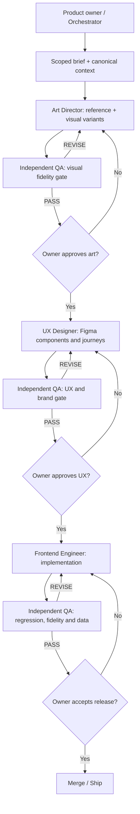

# Production Orchestration and Approval Protocol

## Human-in-the-loop authority
The owner/product lead approves **artistic direction, visual brand master, major journey decisions and release**. An AI reviewer can recommend approval but cannot grant it. Distinct agents must not mark their own outputs `APPROVED`.

## Operating phases

## Lifecycle and status contract
`BACKLOG → BRIEFED → IN_ART → ART_QA → ART_APPROVED → IN_UX → UX_QA → UX_APPROVED → IN_CODE → CODE_QA → RELEASE_APPROVED → DONE`.

Exceptional states: `BLOCKED`, `NEEDS_REVISION`, `RESEARCH_REQUIRED`. Status is written in the task ticket and linked artifact's frontmatter; never inferred from “looks done.” `APPROVED` requires a recorded human approver, date, artifact version/commit and link.

## Work-item identifiers
`VF-###` art; `UX-###` interaction; `FE-###` code; `QA-###` validation; `RS-###` research. First focus `VF-001: Player Hub Fidelity`, followed by `VF-002: Quest Panel Material Grammar` and `VF-003: Skill Tree`. Do not mix unapproved art tickets into frontend implementation.

## Agent handoff rules
- Each agent loads the versioned project context and exact upstream packet. Chat history on one platform is **not** assumed available to another.
- Each output follows `HANDOFF_CONTRACT.md` and links reproducible files, not statements like “see the chat.”
- If referenced image, generated asset, Figma node or repository SHA is inaccessible, report `BLOCKED: REFERENCE_MISSING`; do not substitute a guessed design.
- An agent may question an upstream decision, but changes require a new proposal and owner/QA review.
- Dependencies are explicit; do not implement fake integrations or backend claims.
- Orchestrator maintains a `docs/agents/DECISION_LOG.md` record for approved decisions and a task backlog; do not retroactively rewrite past outcomes.

## Cross-platform operation
**GitHub is shared long-term memory**, not the individual agent's chat. Suggested:
- ChatGPT/Codex: orchestrator, repo/product analysis, UX or frontend implementation.
- Gemini Gem: art direction + controlled image prompt/asset experimentation, given the same repo packet.
- Claude Code: independent engineering or QA **only if deliberately assigned that role**; avoid two uncoordinated agents editing the same files.
- Figma: editable design source; status is `EXPLORATION`, `CANDIDATE`, `APPROVED`, or `IMPLEMENTED`.
- Google Drive: optional **asset store**, with documented share/access permissions; GitHub keeps only the asset manifest, links, prompts, decisions and approved small web deliverables as appropriate.

### Chat/context bridge
Do **not** rely on making the current private conversation “readable to every agent.” Instead:
1. Update `PROJECT_CONTEXT_AND_LEARNINGS_2026-11-07.md` at the end of major sessions.
2. Capture exact owner approvals into the Decision Log.
3. Create an issue/handoff packet with refs to approved images, GitHub files, Figma nodes and artifacts.
4. Give each external agent the onboarding text in `AGENT_BOOTSTRAP.md` (or paste into the platform's custom instructions).
5. On return, require the output contract and integrate findings into the repo.
A user-controlled conversation export or share link can supplement this, but may expose private conversation content and is not a dependable machine-readable source of truth.

## Conflict resolution
Product owner > explicit current human approval/decision log > current ticket acceptance criteria > approved visual artifact > versioned handoff > historical brainstorm. Superseded or provisional docs **cannot** overrule current decisions. When two sources conflict, block and raise a decision request. Never silently overwrite design authority.

## Sprint cadence
1. 15-minute brief: outcome, source reference, scope, non-goals and measurable exit.
2. Art review: candidates + source side-by-side + QA critique.
3. Owner art checkpoint; accept or revise.
4. UX prototype review: playable first/return journeys + error states.
5. Technical estimate/handoff, implementation, automated checks and independent QA.
6. End-of-day update: decisions, status changes, blockers, new assets, next owner action.

## First milestone definition
One **high-fidelity Player Hub** with original asset kit and source-matched visual grammar, accepted by owner; one editable Figma build using those approved assets with clickable first quest and basic second-visit path; independent QA evidence. Not 15 medium-quality screens.
